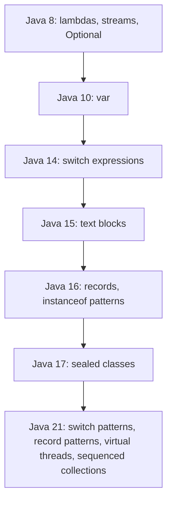
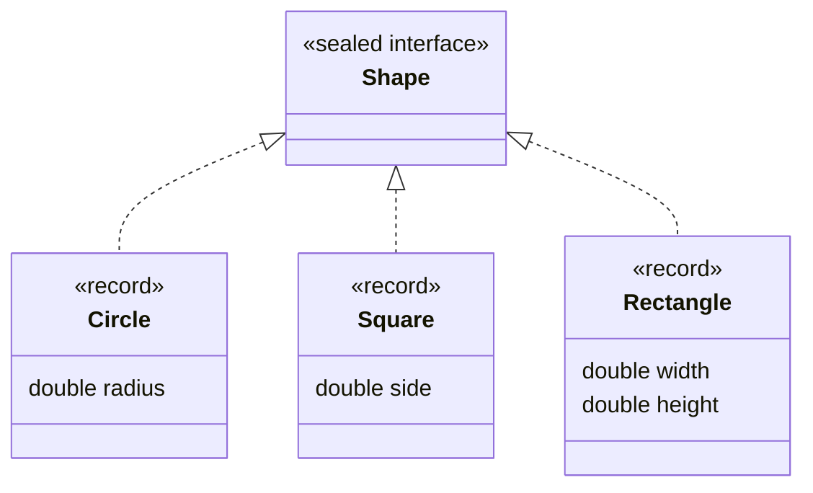

# Java, release by release

Small, tested examples of the Java features that changed how everyday Java is written, from Java 8 to Java 21.
Each feature is one short class in `src/main/java` and one JUnit test in `src/test/java`. Read the class, run
the test, then change something and watch the test tell you what you broke.

Read first: [the Java section of the guide](https://enrichmeai.com/well-rounded-engineer/java/).

## What you need

- A JDK, version 21 or newer (21 and 25 are the current LTS releases). Check with `java -version`.
- Maven 3.9 or newer. Check with `mvn -v`.

## Run it

```bash
cd java
mvn test
```

You should see `Tests run: 31, Failures: 0, Errors: 0, Skipped: 0` and `BUILD SUCCESS`.

To run one example's test only:

```bash
mvn test -Dtest=SealedShapesTest
```

## The examples, and the release that introduced each

| Release | Feature | Example | Test |
|---|---|---|---|
| Java 8 | Lambdas and the Stream API | [`LambdasAndStreams`](src/main/java/com/enrichmeai/wre/javatour/LambdasAndStreams.java) | [`LambdasAndStreamsTest`](src/test/java/com/enrichmeai/wre/javatour/LambdasAndStreamsTest.java) |
| Java 8 | `Optional` | [`OptionalValues`](src/main/java/com/enrichmeai/wre/javatour/OptionalValues.java) | [`OptionalValuesTest`](src/test/java/com/enrichmeai/wre/javatour/OptionalValuesTest.java) |
| Java 10 | `var` for local variables (and Java 11: `var` in lambda parameters) | [`LocalVariableTypeInference`](src/main/java/com/enrichmeai/wre/javatour/LocalVariableTypeInference.java) | [`LocalVariableTypeInferenceTest`](src/test/java/com/enrichmeai/wre/javatour/LocalVariableTypeInferenceTest.java) |
| Java 14 | Switch expressions (arrow labels, several labels per case, `yield`) | [`SwitchExpressions`](src/main/java/com/enrichmeai/wre/javatour/SwitchExpressions.java) | [`SwitchExpressionsTest`](src/test/java/com/enrichmeai/wre/javatour/SwitchExpressionsTest.java) |
| Java 15 | Text blocks | [`TextBlocks`](src/main/java/com/enrichmeai/wre/javatour/TextBlocks.java) | [`TextBlocksTest`](src/test/java/com/enrichmeai/wre/javatour/TextBlocksTest.java) |
| Java 16 | Records, and pattern matching for `instanceof` | [`Records`](src/main/java/com/enrichmeai/wre/javatour/Records.java) | [`RecordsTest`](src/test/java/com/enrichmeai/wre/javatour/RecordsTest.java) |
| Java 17 | Sealed classes and interfaces | [`SealedShapes`](src/main/java/com/enrichmeai/wre/javatour/SealedShapes.java) | [`SealedShapesTest`](src/test/java/com/enrichmeai/wre/javatour/SealedShapesTest.java) |
| Java 21 | Pattern matching for `switch`, and record patterns | [`SealedShapes`](src/main/java/com/enrichmeai/wre/javatour/SealedShapes.java) | [`SealedShapesTest`](src/test/java/com/enrichmeai/wre/javatour/SealedShapesTest.java) |
| Java 21 | Virtual threads | [`VirtualThreads`](src/main/java/com/enrichmeai/wre/javatour/VirtualThreads.java) | [`VirtualThreadsTest`](src/test/java/com/enrichmeai/wre/javatour/VirtualThreadsTest.java) |
| Java 21 | Sequenced collections (`getFirst`, `getLast`, `reversed`) | [`SequencedCollections`](src/main/java/com/enrichmeai/wre/javatour/SequencedCollections.java) | [`SequencedCollectionsTest`](src/test/java/com/enrichmeai/wre/javatour/SequencedCollectionsTest.java) |

The same table as a path through the releases. Each box is a release; read it top to bottom to see how everyday Java changed.



A few smaller APIs appear along the way: `String.strip()` (Java 11), `String.formatted()` (Java 15) and
`Thread.sleep(Duration)` (Java 19).

### Where the release numbers come from

They were checked against the OpenJDK source code at the `jdk-25-ga` tag, not written from memory:

- **Language features**: the `Feature` list in javac's
  [`Source.java`](https://github.com/openjdk/jdk/blob/jdk-25-ga/src/jdk.compiler/share/classes/com/sun/tools/javac/code/Source.java)
  names the first release each one is allowed in: `LOCAL_VARIABLE_TYPE_INFERENCE(JDK10)`,
  `VAR_SYNTAX_IMPLICIT_LAMBDAS(JDK11)`, `SWITCH_EXPRESSION(JDK14)`, `TEXT_BLOCKS(JDK15)`, `RECORDS(JDK16)`,
  `PATTERN_MATCHING_IN_INSTANCEOF(JDK16)`, `SEALED_CLASSES(JDK17)`, `PATTERN_SWITCH(JDK21)`, `RECORD_PATTERNS(JDK21)`.
- **Library features**: the `@since` tag in each class's Javadoc: `java.util.stream.Stream`,
  `java.util.function.Function` and `java.util.Optional` say `@since 1.8`; `java.util.SequencedCollection` and
  `java.util.SequencedMap` say `@since 21`; `Thread.ofVirtual()` and `Executors.newVirtualThreadPerTaskExecutor()`
  say `@since 21`.

## Why Java 21 and not 25?

Java 25 is the newest LTS. This project compiles for Java 21 (`maven.compiler.release` in `pom.xml`) because the
examples were written and run on a JDK 21, and every example here is something that ran. The code runs unchanged
on 25, and CI tests it on both 21 and 25.

Features from Java 22 to 25 are not here yet: unnamed variables `_` (22), primitive types in patterns (23, still a
preview), flexible constructor bodies and module import declarations (25). They will come in their own folder once
they can be run and tested, rather than described.

Why try-this 1 works. `sealed ... permits` tells the compiler the full list of shapes, so a `switch` over a `Shape` can be checked for a missing case. Add a fourth shape and every `switch` that does not handle it stops compiling.



## Try this

1. In `SealedShapes`, add a `Triangle` record to the `permits` list. Run `mvn test` and read the compiler errors:
   every `switch` that forgot the new shape is listed for you. Then make them compile.
2. Rewrite `LambdasAndStreams.sumOfEvens` as a plain `for` loop. Do the tests still pass? Which version is easier
   to read?
3. In `VirtualThreads`, replace `Executors.newVirtualThreadPerTaskExecutor()` with
   `Executors.newFixedThreadPool(10)` and run the test. It takes well over a minute and then fails. Why?
4. Remove the compact constructor from `Records.Money` and write a test that creates `new Money(-1, "GBP")`.
   What does the record let through that it should not?

## Read next

- [Java, in the guide](https://enrichmeai.com/well-rounded-engineer/java/)
- The design patterns in [`../patterns/`](../patterns/) are written with these features.
