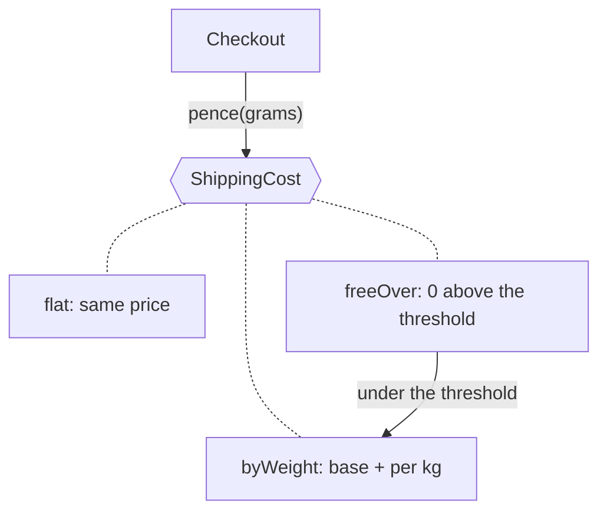
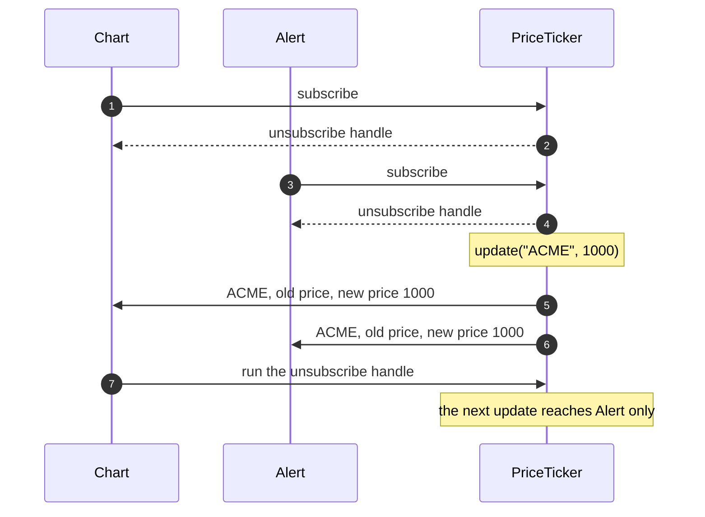
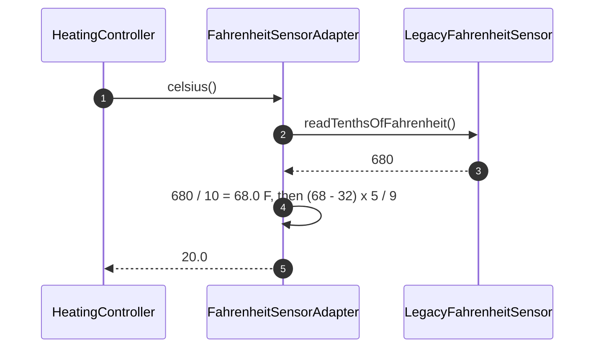

# Design patterns (Gang of Four)

Three of the 23 patterns from *Design Patterns: Elements of Reusable Object-Oriented Software* (Gamma, Helm,
Johnson and Vlissides, 1994), written in modern Java, each with tests. A pattern is a name for a solution that
keeps turning up. The name is the useful part: "make it a strategy" says in three words what would otherwise take
a paragraph.

Read first: [the History section of the guide](https://enrichmeai.com/well-rounded-engineer/history/).

## Run it

You need a JDK 21 or newer and Maven 3.9 or newer.

```bash
cd patterns
mvn test
```

You should see `Tests run: 9, Failures: 0, Errors: 0, Skipped: 0` and `BUILD SUCCESS`.

## The patterns

### Strategy: swap how a job is done

[`strategy/`](src/main/java/com/enrichmeai/wre/patterns/strategy/): a `Checkout` is given a `ShippingCost` and
calls it, without knowing whether postage is flat, by weight, or free over £50.

The checkout calls one method, `pence(grams)`. Which rule answers is decided when the checkout is built. `freeOver` even wraps another strategy for orders under the threshold.



**Use it when** you have several ways of doing one job and the choice changes (by customer, by country, by
configuration), or when an `if`/`else` on "which kind" keeps growing. **Skip it when** there is only one way and
no sign of a second. In modern Java a strategy is often just a lambda, as here.

### Observer: tell whoever is interested

[`observer/`](src/main/java/com/enrichmeai/wre/patterns/observer/): a `PriceTicker` notifies every subscribed
listener when a price changes. It does not know who is listening.

Two listeners subscribe, one price changes, both hear about it. `subscribe` hands back a way to unsubscribe, so a listener can leave.



**Use it when** one change should set off several independent reactions, and you want to add reactions without
editing the thing that changed. **Watch out for** listeners that are never unsubscribed (here, `subscribe`
returns the way to unsubscribe), and for long chains of events that are hard to follow when debugging.

### Adapter: make something fit

[`adapter/`](src/main/java/com/enrichmeai/wre/patterns/adapter/): our `HeatingController` expects a `Thermometer`
in Celsius. A `LegacyFahrenheitSensor` we cannot change reports tenths of a degree Fahrenheit. The
`FahrenheitSensorAdapter` sits between them.

One reading, followed through the adapter. The controller asks for Celsius; the old sensor only speaks tenths of a degree Fahrenheit; the adapter converts in one place.



**Use it when** you need to use a class whose interface does not match yours: a third-party library, old code, a
different team's API. The conversion lives in one place, and the rest of your code never learns about it.

## Try this

1. Add a `ShippingCost` for next-day delivery (a flat £6.99, doubled over 5 kg). Write its test first. Did
   `Checkout` need to change?
2. Add a listener to `PriceTicker` that keeps the highest price it has seen. What happens if a listener throws an
   exception? Write a test that shows it, then decide what should happen.
3. Write an adapter for a second legacy sensor that reports Kelvin, as a `String` like `"293.15K"`.

## Read next

- [History, in the guide](https://enrichmeai.com/well-rounded-engineer/history/): where patterns came from.
- [`../java/`](../java/): the Java features (lambdas, records, `var`) these examples are written with.
