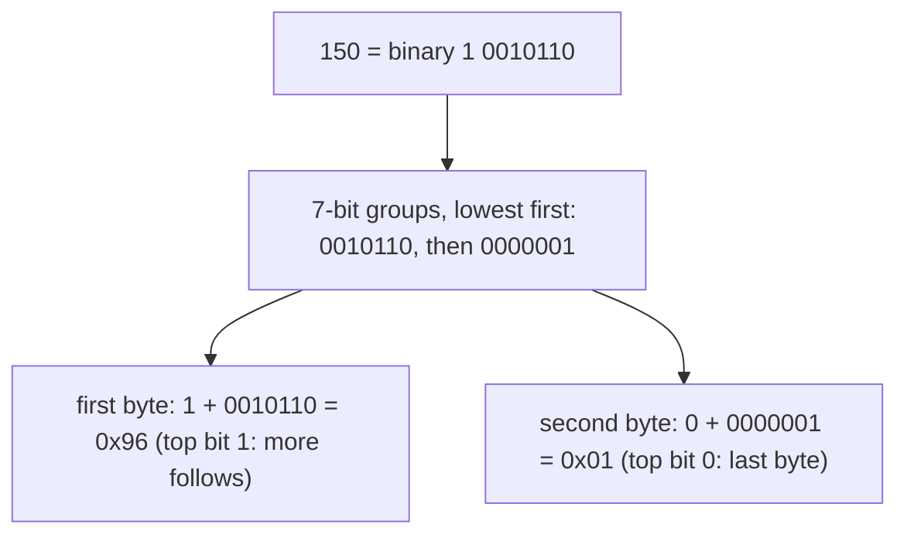
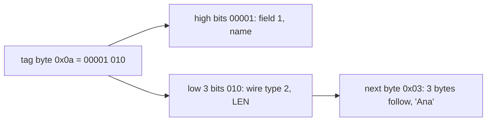
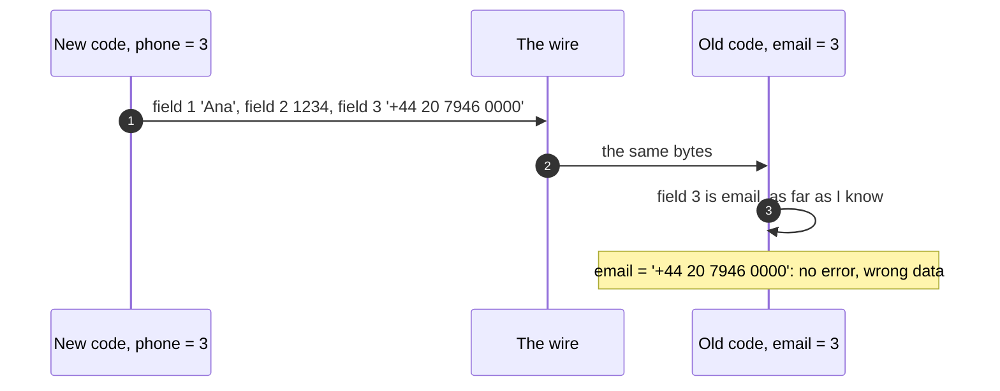

# protobuf: what Protocol Buffers put on the wire, and how to change a schema safely

Protocol Buffers (protobuf) turn a message into compact bytes using a schema, a `.proto` file. Libraries usually hide
the bytes. Here you see every one: a small encoder written by hand produces the **same bytes** as Google's library,
and a decoder reads any message back without its schema. Then the part that matters most in production: which
schema changes are safe while old and new code run side by side, and which silently corrupt data.

| File | What it shows |
|---|---|
| [`person.proto`](person.proto) | The schema: names for people, **numbers** for the wire |
| [`wire.py`](wire.py) | The wire format by hand: varints, tags, length-prefixed strings; no library |
| [`schema.py`](schema.py) | The same schema built in code for the library (instead of running `protoc`) |
| [`compare.py`](compare.py) | The library's bytes, the hand-made bytes (identical) and JSON's size |
| [`evolve.py`](evolve.py) | One safe change and two unsafe ones, and what old code reads in each case |

## Run it

You need Python 3.10 or newer. From this folder:

```bash
python3 -m pip install -r requirements.txt     # protobuf and pytest, pinned
python3 wire.py
python3 compare.py
python3 evolve.py
python3 -m pytest
```

## What happens, step by step

**The wire format.** A message is a list of records. Each record starts with a *tag*, a varint holding
`(field_number << 3) | wire_type`: wire type 0 (`VARINT`) for integers, 2 (`LEN`) for strings, bytes and nested
messages. A varint stores 7 bits per byte, lowest first, and sets the top bit of a byte when another byte follows. So
150 is `96 01`. Field names never go on the wire. `wire.py` accounts for every byte:

```text
150 as a varint: 96 01
Person(name='Ana', id=1234, email='ana@example.com') is 25 bytes:
0a 03 41 6e 61                                       field 1, LEN    3 bytes 'Ana'
10 d2 09                                             field 2, VARINT 1234
1a 0f 61 6e 61 40 65 78 61 6d 70 6c 65 2e 63 6f 6d   field 3, LEN    15 bytes 'ana@example.com'
```

How 150 becomes `96 01`: cut the number into 7-bit groups, lowest group first, and set the top bit on every byte except the last.



`0a` is field 1, wire type 2: `(1 << 3) | 2 = 10`. `10` is field 2, wire type 0: `(2 << 3) | 0 = 16`. `1a` is field 3,
wire type 2.

One tag byte, taken apart. The low 3 bits are the wire type; the rest is the field number.



**The library agrees.** `compare.py` builds the same message with Google's protobuf library:

```text
protobuf library :  25 bytes  0a 03 41 6e 61 10 d2 09 1a 0f 61 6e 61 40 65 78 61 6d 70 6c 65 2e 63 6f 6d
by hand (wire.py):  25 bytes  identical
JSON             :  55 bytes  {"name": "Ana", "id": 1234, "email": "ana@example.com"}
read back        : name='Ana' id=1234 email='ana@example.com'
```

**Changing the schema.** During a rollout, old code reads messages written by new code. `evolve.py` makes three new
versions of `Person` and reads each one's output with version 1:

```text
1. SAFE   add phone = 4          old code reads: name='Ana' id=1234 email='ana@example.com'
                                 and passes phone on unchanged: True
2. UNSAFE renumber email/id      old code reads: name='Ana' id=0 email=''
3. UNSAFE reuse 3 for phone      old code reads: name='Ana' id=1234 email='+44 20 7946 0000'
```

Case 3, step by step. Old and new code agree on field numbers, not names, so a reused number carries the phone number straight into the old `email` field.



1. Adding a field with a new number is safe. Old code does not know field 4, keeps it as an *unknown field*, and
   includes it when it serialises the message again, so nothing is lost on the way through.
2. Renumbering raises no error. Old code finds a string where it expects field 2's integer, sets the record aside as
   unknown, and reports `id=0` and an empty email: the data is silently gone.
3. Reusing a deleted field's number is worse. The phone number arrives in the `email` field, with no error. The protobuf
   language guide warns that reusing field numbers can lead to "Leaked PII/SPII" and "Data corruption". Its rule:
   never reuse a field number, and mark deleted ones `reserved`.

## Try next

1. In `wire.py`, encode `id = -1`. Why does it take ten bytes? Then look up `sint32` and ZigZag encoding in the
   encoding guide, and add it.
2. Give `Person` a field numbered 16. How many bytes does its tag take now? (Numbers 1 to 15 fit in one byte.)
3. Write `wire.decode` output for a message from `evolve.PersonV2`. You can read field 4 without any schema: this is
   what an old service's unknown-field handling sees.
4. Add `reserved 3;` to a copy of `person.proto`, then try to declare a new field with number 3 and compile it with
   `protoc`. What does the compiler say?
5. Install `protoc` and generate `person_pb2.py` from `person.proto`. Check it produces the same 25 bytes.

## Read

- [How APIs evolved](https://enrichmeai.com/well-rounded-engineer/apihistory/) in the guide (Protocol Buffers and gRPC).
- [Protobuf encoding](https://protobuf.dev/programming-guides/encoding/): the wire format, varints and wire types.
- [Language guide (proto3)](https://protobuf.dev/programming-guides/proto3/): field numbers, `reserved`, unknown fields.
