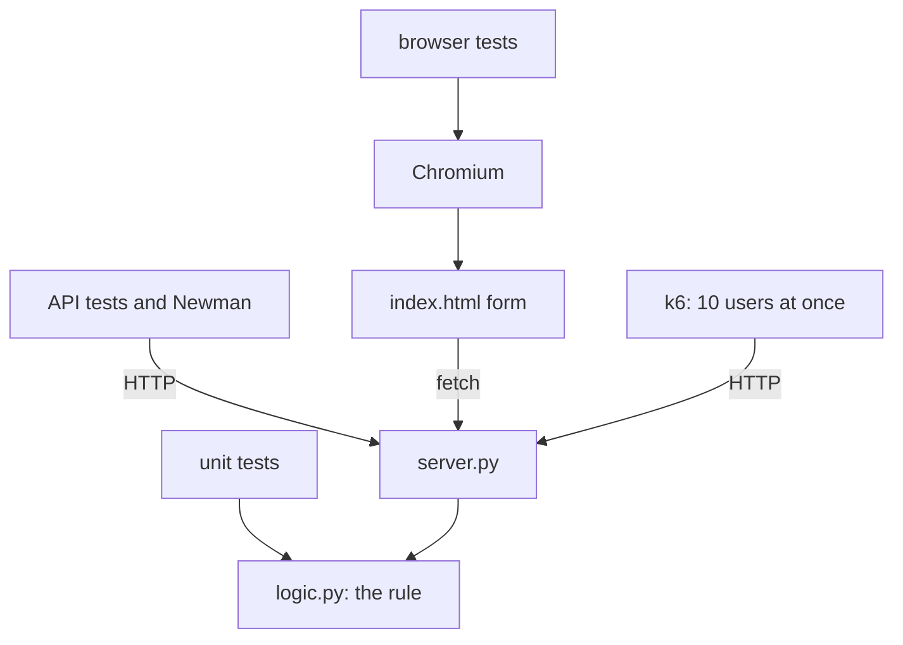

# Testing at several levels, against one tiny app

One small web app, a tip splitter, tested five ways. Each kind of test answers a different question, costs a
different amount, and catches a different kind of mistake. Seeing them side by side, against the same app, is the
quickest way to learn which one to reach for.

Read first: [the Testing section of the guide](https://enrichmeai.com/well-rounded-engineer/testing/).

## The app

[`tipsplit/`](tipsplit/) uses only Python's standard library:

- [`logic.py`](tipsplit/logic.py): the rule. Split a bill and a tip between people, each share rounded up to
  the penny so the bill is always covered.
- [`server.py`](tipsplit/server.py): a JSON API (`/api/split?total=60&people=3&tip=10`, `/api/health`) and
  one page.
- [`static/index.html`](tipsplit/static/index.html): a form that calls the API.

Run it and open http://127.0.0.1:8000/ in your browser:

```bash
cd testing
python3 -m tipsplit.server --port 8000
```

## The tests

| Level | What it checks | Where | Speed |
|---|---|---|---|
| Unit | the rule alone: no server, no browser | [`tests/unit/`](tests/unit/) | milliseconds |
| API | real HTTP requests: status codes, content type, the JSON contract | [`tests/api/`](tests/api/) | milliseconds |
| Browser | a real Chromium, driven by Playwright, filling in the form like a person | [`tests/browser/`](tests/browser/) | about a second each |
| API, from Postman | the same contract as a Postman collection, run by Newman | [`postman/`](postman/) | milliseconds |
| Load | how response times hold up with 10 users at once, with k6 | [`k6/`](k6/) | about 30 seconds |

Notice the shape: many unit tests, fewer API tests, only three browser tests. Each step up is slower and more
fragile, but closer to what a person does. [`tests/conftest.py`](tests/conftest.py) starts the app on a free port
for the API and browser tests, so you do not have to.

What each kind of test actually touches. Each one goes through more of the app than the one before it, which is why it catches more and runs slower.



## Run it

You need Python 3.10 or newer. For Newman you also need Node.js 16 or newer.

```bash
cd testing
python3 -m venv .venv
source .venv/bin/activate        # on Windows: .venv\Scripts\activate
pip install -r requirements.txt
python -m playwright install chromium    # downloads the browser Playwright drives, once
pytest -v
```

You should see `18 passed`. Run one level only with `pytest tests/unit`, `pytest tests/api` or
`pytest tests/browser`.

If you already have a Chromium build that suits your Playwright version, you can point the browser tests at it
instead of downloading one: `CHROMIUM_EXECUTABLE=/path/to/chrome pytest tests/browser`.

### The Postman collection, with Newman

```bash
npm install
scripts/run-newman.sh
```

The script starts the app on port 8765, runs the collection, and stops the app. It reports `assertions 6, failed 0`.
If port 8765 is busy, it says so: run `PORT=8766 scripts/run-newman.sh`. You can also import
[`postman/tipsplit.postman_collection.json`](postman/tipsplit.postman_collection.json) into the Postman app and
set `baseUrl` to wherever the app is running.

### The load test, with k6

[`k6/load-test.js`](k6/load-test.js) needs [k6](https://github.com/grafana/k6) installed. Start the app in one
terminal, then in another:

```bash
k6 run -e BASE_URL=http://127.0.0.1:8000 k6/load-test.js
```

It fails if the 95th percentile response time reaches 500 ms or more than 1% of checks fail. CI runs it on every
change. (It was not run where these examples were written, because k6 could not be installed there; CI is where
it runs.)

## Try this

1. Change the rounding in `logic.py` from `ROUND_UP` to `ROUND_HALF_UP`. Which test fails, and at which level?
   Would a browser test alone have told you why?
2. Add a "Round each share to the nearest pound" checkbox. Write the unit test first, then the API test, then
   one browser test. Notice how much code each one takes.
3. In `tests/browser/test_page.py`, change `get_by_label("Bill total")` to `locator("#total")`. Both work. Rename
   the label in `index.html` and run the tests again: which kind of selector caught that a person could no
   longer find the field?
4. Raise the k6 stages to 200 virtual users and run it. Where does the standard-library server start to slow down?

## Read next

- [Testing, in the guide](https://enrichmeai.com/well-rounded-engineer/testing/)
- [`../python/`](../python/) for the Python idioms used in the app (dataclasses, pathlib, f-strings).
